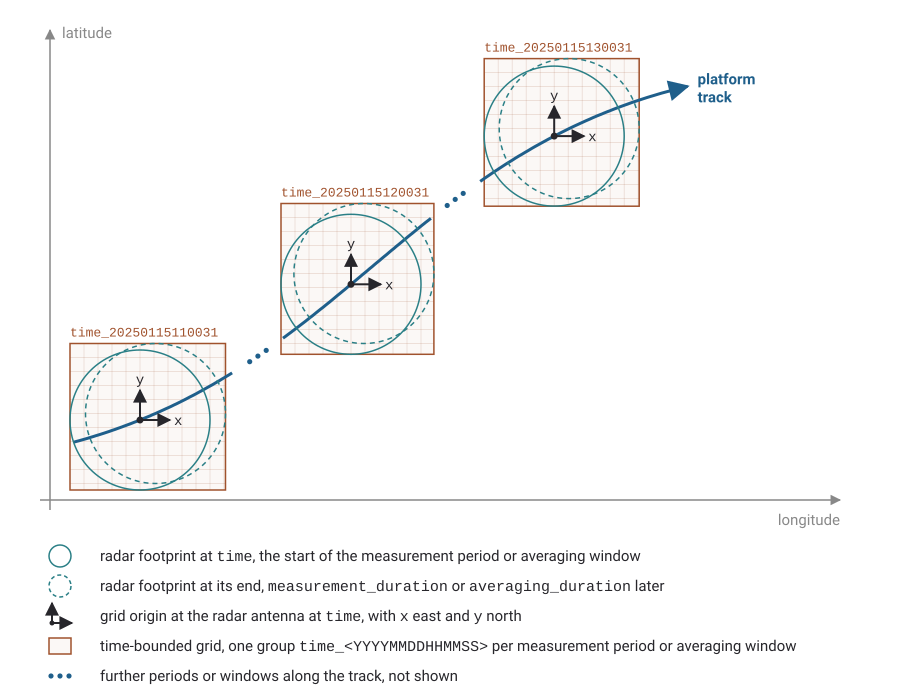

# Georeferencing

## Polar sensor coordinates

[Level 1a data](../product_types/polar.md) and [Level 1b polar images](../product_types/polar.md#image-cube) are stored in the polar coordinates of the sensor, `range` and `azimuth`, with the radar antenna at the origin.
The `azimuth` variable holds the antenna angle as recorded by the radar relative to its zero direction; on a ship, this is typically the bow.
This differs from FM 301, which defines `azimuth` relative to true north; SOMaR polar data are stored as recorded without modification.
The elevation angle that FM 301 stores for every ray is not used, since a marine radar scans horizontally only.

Whether the platform moves is stated by the global attribute [`platform_is_mobile`](../metadata_attributes/optional_global.md#platform_is_mobile) (`"true"` or `"false"`; assumed `"false"` if missing, so that every file from a moving platform must set it to `"true"`).

They are located in space with variables from the WMO-CF Radial profile [FM 301][fm301] and the [CfRadial 2.1][cfradial] draft:

- Scalar [`altitude`](../product_types/polar.md#altitude) in the root group gives the height of the radar antenna above mean sea level (FM 301). SOMaR assumes it constant for both fixed and moving platforms, whereas CfRadial 2.1 also allows `altitude(time)` in the `georeference` group.
- For a fixed platform, scalar `latitude` and `longitude` in the root group give the position of the radar antenna (FM 301).
- For a moving platform (`platform_is_mobile = "true"`), platform position and orientation should be recorded in `latitude` (double; `degrees_north`), `longitude` (double; `degrees_east`), and [`heading`](../product_types/polar.md#heading) (float; `degree`, standard name `platform_orientation`), following CfRadial 2.1 (Section 5.4). All navigation variables within a group or subgroup must use the same representation, provided either **per sweep** (scalar at the start of each sweep, i.e. at the time of its first ray; a SOMaR addition, as CfRadial defines them per ray only) or **per ray** (dimension `time`, keeping the full resolution of navigation data as in CfRadial, which, like FM 301, indexes `time` by ray):
  - **Level 1a**: stored in each sweep's `georeference` subgroup, either as scalars (per sweep) or with dimension `time` (per ray; see [Sweep groups](../product_types/polar.md#sweep-groups)). Scalar `latitude` and `longitude` in the root group, which FM 301 requires, give the position at the start of the file.
  - **Level 1b polar**: stored in the root group with dimension `time` (per sweep) or `(time, azimuth)` (per ray).

  Position and heading are recommended rather than required for a moving platform, since they may not be available when the file is written, e.g. in real-time recording, or may be taken from a separate navigation data stream; a file without them is not georeferenced (see [Moving platforms](../product_types/polar.md#moving-platforms)).

## Applying georeference corrections

In polar products ([Level 1a](../product_types/polar.md) and [Level 1b polar](../product_types/polar.md#image-cube)), `azimuth`, `range`, `time`, and platform position are stored as recorded by the instrument, and the corrections have not been applied.
Known offsets of the recorded pointing direction, range, time, and platform position are stored in the optional `georeference_correction` group in the root group (see [Georeference correction parameters](../metadata_attributes/georeference_correction.md)).
The azimuth, range, and time offsets of a ship-borne radar can be estimated from the imagery itself (McCann and Bell [2018](../references/index.md#mccann-bell-2018)).
Users must apply these constant offsets to the recorded values to obtain corrected values; a missing variable is equivalent to a correction of 0:

- **Azimuth**: The azimuth of a ray relative to true north, clockwise positive, is `(azimuth + azimuth_correction + heading) mod 360`, where [`heading`](../product_types/polar.md#heading) is taken from the navigation variables (the `georeference` subgroup at Level 1a or the root group at Level 1b polar) and [`azimuth_correction`](../metadata_attributes/georeference_correction.md#azimuth_correction) from the `georeference_correction` group. For a fixed platform, there is no `heading`, and `azimuth_correction` is the direction of the radar's zero direction relative to true north.
- **Range**: The corrected slant range $R_s$ is `range + range_correction`. The ground range $R_g$ follows from the corrected slant range and the antenna height $h$ ([`altitude`](../product_types/polar.md#altitude)) above mean sea level as $R_g = \sqrt{R_s^2 - h^2}$ for $R_s \ge h$. Range gates where $R_s \lt h$ fall inside the platform near-field or nadir blind zone, do not intersect the sea surface, and are left unmapped or set to the [`_FillValue`](../metadata_attributes/variable_attributes.md#_FillValue) when projecting to horizontal coordinates.
- **Time**: The corrected time is `time + time_correction`.
- **Platform position**:<a id="position-offset"></a> Where the position of a moving platform has been taken from a GPS antenna at a different location on the platform, [`position_offset_x`](../metadata_attributes/georeference_correction.md#position_offset_x) and [`position_offset_y`](../metadata_attributes/georeference_correction.md#position_offset_y) give the position of the radar antenna relative to the GPS antenna in a ship frame (x-axis positive to starboard, y-axis positive toward the bow). With heading $H$ (in degrees clockwise from true north, converted to radians for trigonometric evaluation), the radar antenna's displacement in meters east and north of the recorded position is:

    ```
    east  =  position_offset_x * cos(H) + position_offset_y * sin(H)
    north = -position_offset_x * sin(H) + position_offset_y * cos(H)
    ```

    The conversion to `latitude` and `longitude` is carried out on the WGS 84 ellipsoid. The offsets are horizontal distances for a level ship (roll and pitch are neglected); for a fixed platform, position offsets are not used. They replace the `latitude_correction` and `longitude_correction` of CfRadial 2.1, which are constant in degrees and therefore valid for a single heading only.

In [gridded](../product_types/gridded.md) and [spatially averaged](../product_types/spatially_averaged.md) products, i.e. the Level 1b Cartesian images and all Level 2 products, these corrections have already been applied during grid generation, so this group is omitted.

## Coordinate reference system variables

Georeferenced data variables reference a scalar `char` coordinate reference system (CRS) variable, conventionally named `crs`, through a [`grid_mapping`](../metadata_attributes/variable_attributes.md#grid_mapping) attribute, following standard CF practice.
All attributes of the `crs` variable are listed, with their origin and permitted values, under [Variable attributes](../metadata_attributes/variable_attributes.md#coordinate-reference-system-variables).

SOMaR uses two coordinate reference systems:

### Geographic coordinates

Used by [spatially averaged products](../product_types/spatially_averaged.md) and by Level 2 maps on an Earth-fixed longitude/latitude grid (see [Gridded products](../product_types/gridded.md#geographic-grid)).
On these grids, `crs` is recommended rather than required: without it, the data variables carry no `grid_mapping` attribute, and `latitude` and `longitude` refer to WGS 84.
The local grids below always require it, since its projection origin locates the grid.
The `crs` variable specifies `grid_mapping_name = "latitude_longitude"` (see [Latitude-longitude][cf-latitude-longitude] in the CF conventions), describes the reference ellipsoid ([`longitude_of_prime_meridian`](../metadata_attributes/variable_attributes.md#longitude_of_prime_meridian), [`semi_major_axis`](../metadata_attributes/variable_attributes.md#semi_major_axis), [`inverse_flattening`](../metadata_attributes/variable_attributes.md#inverse_flattening)), and names the reference ellipsoid, the prime meridian, the geodetic datum, and the geographic coordinate reference system ([`reference_ellipsoid_name`](../metadata_attributes/variable_attributes.md#reference_ellipsoid_name), [`prime_meridian_name`](../metadata_attributes/variable_attributes.md#prime_meridian_name), [`horizontal_datum_name`](../metadata_attributes/variable_attributes.md#horizontal_datum_name), [`geographic_crs_name`](../metadata_attributes/variable_attributes.md#geographic_crs_name)), which CF requires together if any of them is given:

```
variables:
        char crs ;
                crs:grid_mapping_name = "latitude_longitude" ;
                crs:longitude_of_prime_meridian = 0. ;
                crs:semi_major_axis = 6378137. ;
                crs:inverse_flattening = 298.257223563 ;
                crs:reference_ellipsoid_name = "WGS 84" ;
                crs:prime_meridian_name = "Greenwich" ;
                crs:horizontal_datum_name = "World Geodetic System 1984" ;
                crs:geographic_crs_name = "WGS 84" ;
data:
        crs = " " ;
```

### Time-bounded local grids

Marine radars measure natively in meters, as range and bearing from the antenna. Cartesian image products ([relative roughness images](../annex/relative_roughness_images.md) and [relative roughness image mosaics](../annex/relative_roughness_mosaics.md)) and [Level 2 maps on the local grid](../product_types/gridded.md#local-grid) preserve this geometry on a radar-centric grid:

- `x` and `y` are distances in meters east and north of the origin, on a flat plane. The `y` axis points to true north, not to the grid north of any map projection; from a fixed platform, the grid may instead be rotated (see [Rotated local grids](#rotated-local-grids)).
- The origin is the position of the radar antenna at the start of the measurement, i.e. the concurrent GPS position after application of the [position offsets](#position-offset).

In CF terms, this plane is described as an azimuthal equidistant projection on the WGS 84 ellipsoid, centered on the origin (see [Azimuthal equidistant][cf-azimuthal-equidistant] in the CF conventions). This projection preserves distance and bearing from its center; distances between other points on the plane differ from those on the ellipsoid by less than a millimeter within 5 km of the center and by a few millimeters within 10 km, far less than the range resolution of the radar. The `crs` variable specifies `grid_mapping_name = "azimuthal_equidistant"`, the origin ([`longitude_of_projection_origin`](../metadata_attributes/variable_attributes.md#longitude_of_projection_origin), [`latitude_of_projection_origin`](../metadata_attributes/variable_attributes.md#latitude_of_projection_origin)), the reference ellipsoid, and the same four names as the geographic coordinates. Each time-bounded grid also carries a scalar `time` giving the start of the measurement:

```
variables:
        char crs ;
                crs:grid_mapping_name = "azimuthal_equidistant" ;
                crs:longitude_of_projection_origin = 145.868167860183 ;
                crs:latitude_of_projection_origin = 14.9952749946079 ;
                crs:longitude_of_prime_meridian = 0. ;
                crs:semi_major_axis = 6378137. ;
                crs:inverse_flattening = 298.257223563 ;
                crs:reference_ellipsoid_name = "WGS 84" ;
                crs:prime_meridian_name = "Greenwich" ;
                crs:horizontal_datum_name = "World Geodetic System 1984" ;
                crs:geographic_crs_name = "WGS 84" ;
        double time ;
                time:calendar = "standard" ;
                time:long_name = "start time of radar measurement" ;
                time:standard_name = "time" ;
                time:units = "seconds since 1970-01-01T00:00:00Z" ;
                time:time_iso_8601 = "2025-01-15T11:00:31.417000Z" ; // optional
data:
        crs = " " ;
        time = 1736938831.417 ;
```

Because the origin changes as a platform moves, each local grid is valid only for a limited time window. Rather than one global grid for the whole file, relative roughness images, mosaics, and local-grid Level 2 maps from a moving platform store each time-bounded grid as a sibling NetCDF group named `time_<YYYYMMDDHHMMSS>`, with its own `crs` and coordinate variables:
- Each group carries a scalar `double` variable `time` giving the start time of the measurement (`units = "seconds since 1970-01-01T00:00:00Z"`), optionally complemented by a human-readable [`time_iso_8601`](../metadata_attributes/variable_attributes.md#time_iso_8601) string (see [Variable attributes](../metadata_attributes/variable_attributes.md)).
- Local-grid Level 2 maps additionally store two-dimensional `longitude` and `latitude` auxiliary coordinates for their analysis windows (see [Positions of analysis windows](#positions-of-analysis-windows)).

<figure id="figure-time-bounded-grids">

<figcaption>Time-bounded local grids from a moving platform. Each measurement period, or averaging window of a relative roughness image, has its own grid, which covers the radar footprint over the period and has its origin at the radar antenna at its start, given by <code>time</code>; the grid is stored in a group named after that time. The figure is to scale for a platform moving at 5 m/s, a footprint of 5 km radius, and periods of 240 s, during which the platform moves 1.2 km; of the periods along the track, one per hour is shown.</figcaption>
</figure>

From a fixed platform, the origin does not move, and Level 2 products on the local grid are stored on a single grid with one `crs` for the whole file (see [Gridded products](../product_types/gridded.md#fixed-platform)).
[Level 1b Cartesian images](../product_types/gridded.md#image-cube-with-moving-origin) are stored as one cube instead, the third form of gridded products: all images share `x` and `y`, the origin of each image is given by `longitude` and `latitude` on the `time` dimension, and from a moving platform there is no `crs`, since a single `crs` variable can describe only one origin; from a fixed platform, the cube has one `crs`, like the other single grids.

### Rotated local grids

From a fixed platform, the local grid may be rotated about its origin, for example into the along-shore and cross-shore directions of a coastal site; north-oriented grids remain the default.
On a rotated grid, `y` is the distance along the axis whose direction is given by [`azimuth_of_y_axis`](../metadata_attributes/variable_attributes.md#azimuth_of_y_axis), in degrees clockwise from true north, and `x` the distance along the axis 90° clockwise from it, so that the axes remain right-handed; the origin is the radar antenna, as on the north-oriented grid.
The `crs` variable specifies `grid_mapping_name = "rotated_azimuthal_equidistant"`, with the attributes of the azimuthal equidistant projection, `azimuth_of_y_axis`, and [`crs_wkt`](../metadata_attributes/variable_attributes.md#crs_wkt) (see below).
With $\alpha$ the azimuth of the y axis (converted to radians for trigonometric evaluation), a point at `x` and `y` lies at the distances in meters east and north of the origin

```
east  =  x * cos(α) + y * sin(α)
north = -x * sin(α) + y * cos(α)
```

on the plane of the azimuthal equidistant projection, from which its longitude and latitude follow as on the north-oriented grid.
A grid with an azimuth of 0 is the north-oriented grid, which is stored with `grid_mapping_name = "azimuthal_equidistant"`.

CF defines no rotation for the azimuthal equidistant projection: as in the parameter sets of PROJ and EPSG from which the CF grid mappings are taken, its y axis points to north at the projection origin.
SOMaR therefore gives the rotated grid mapping a name of its own, formed like the `rotated_latitude_longitude` of CF, so that software that does not know it leaves the grid unplaced rather than placing it as north-oriented; the angle is stated like the azimuth of the y axis of the Local Orthographic projection of EPSG (method 9837).
This name is not among the grid mappings of CF Appendix F, and it is the only point at which a file on a rotated grid departs from the CF conventions: a CF checker reports it, and software that reads only the CF grid mapping attributes leaves the grid unplaced.

The `crs` of a rotated grid therefore also carries `crs_wkt` (see [Use of the CRS well-known text format][cf-crs-wkt] in the CF conventions), which describes the rotated grid in the well-known text format of ISO 19162:2019 (WKT2), so that software built on PROJ 9.1 or later, such as GDAL, QGIS, and pyproj, places the grid.
It is a derived projected coordinate reference system, `DERIVEDPROJCRS`, made of:

- a base projected coordinate reference system, `BASEPROJCRS`: the azimuthal equidistant projection of the north-oriented grid (EPSG method 1125), on the WGS 84 ellipsoid, with the projection origin as its natural origin and no false easting or northing;
- a deriving conversion, `DERIVINGCONVERSION`, from east and north on that plane to `x` and `y`: the Affine parametric transformation of EPSG (method 9624), whose parameters `A0` to `B2` are those of the inverse of the equations above;
- a Cartesian coordinate system with the axes `(x)` and `(y)` in meters.

```
x = A0 + A1 * east + A2 * north,   A0 = 0,  A1 = cos(α),  A2 = -sin(α)
y = B0 + B1 * east + B2 * north,   B0 = 0,  B1 = sin(α),  B2 = cos(α)
```

The values of `crs_wkt` must agree with the other attributes of `crs`, as CF requires; the CDL below splits it into several strings, which `ncgen` joins.

On a rotated grid, the components of vectors are given along its axes: the near-surface current in [`sea_water_x_velocity`](../product_types/product_variables.md#sea_water_x_velocity) and [`sea_water_y_velocity`](../product_types/product_variables.md#sea_water_y_velocity), the sea ice drift in [`sea_ice_x_velocity`](../product_types/product_variables.md#sea_ice_x_velocity) and [`sea_ice_y_velocity`](../product_types/product_variables.md#sea_ice_y_velocity), and the wavenumbers of a two-dimensional wavenumber spectrum in [`x_wave_wavenumber`](../product_types/product_variables.md#x_wave_wavenumber) and [`y_wave_wavenumber`](../product_types/product_variables.md#y_wave_wavenumber), in place of their eastward and northward counterparts.
Directions, such as [`sea_surface_wave_from_direction`](../product_types/product_variables.md#sea_surface_wave_from_direction), remain bearings from true north, as CF defines them.
Relative roughness images, Level 1b Cartesian images, and Level 2 maps on the local grid may be stored on a rotated grid; maps on the geographic grid may not, since its axes are longitude and latitude.
Spatially averaged products from a fixed platform hold no grid, but may carry the `crs` of a rotated grid centered on the radar antenna to give the axes of their vector components; their `longitude` and `latitude` remain geographic coordinates.

At a coastal site, the axes should follow the convention of the Argus stations and of the Coastal Imaging Research Network (CIRN; Palmsten and Brodie [2022](../references/index.md#palmsten-brodie-2022)): `x` cross-shore, positive offshore, and `y` along-shore, pointing to the left of an observer who faces offshore.
The azimuth of the y axis is then the bearing of the offshore shore normal minus 90°: for a beach that faces east-southeast, with its offshore normal at 110°, it is 20°, and for a coast that runs north–south and faces east, it is 0, the north-oriented grid.
The angle of the [CIRN toolbox](https://github.com/Coastal-Imaging-Research-Network/CIRN-Quantitative-Coastal-Imaging-Toolbox/blob/master/X_CoreFunctions/localTransformFunctions/localTransformPoints.m), from east to the x axis, counterclockwise positive, is the negative of the azimuth of the y axis.
The [`long_name`](../metadata_attributes/variable_attributes.md#long_name) of `x` and `y` and of the vector components should name the axes, such as "cross-shore distance from radar antenna, positive offshore", and a [`comment`](../metadata_attributes/variable_attributes.md#comment) on `crs` the convention:

```
dimensions:
        y = 21 ;
        x = 21 ;
variables:
        char crs ;
                crs:grid_mapping_name = "rotated_azimuthal_equidistant" ;
                crs:azimuth_of_y_axis = 20. ;
                crs:longitude_of_projection_origin = 7.8853 ;
                crs:latitude_of_projection_origin = 54.1826 ;
                crs:longitude_of_prime_meridian = 0. ;
                crs:semi_major_axis = 6378137. ;
                crs:inverse_flattening = 298.257223563 ;
                crs:reference_ellipsoid_name = "WGS 84" ;
                crs:prime_meridian_name = "Greenwich" ;
                crs:horizontal_datum_name = "World Geodetic System 1984" ;
                crs:geographic_crs_name = "WGS 84" ;
                crs:crs_wkt = "DERIVEDPROJCRS[\"SOMaR rotated local grid\",",
                        "BASEPROJCRS[\"SOMaR local grid\",",
                        "BASEGEOGCRS[\"WGS 84\",DATUM[\"World Geodetic System 1984\",ELLIPSOID[\"WGS 84\",6378137,298.257223563,LENGTHUNIT[\"metre\",1]]],PRIMEM[\"Greenwich\",0,ANGLEUNIT[\"degree\",0.0174532925199433]]],",
                        "CONVERSION[\"Azimuthal equidistant\",METHOD[\"Azimuthal Equidistant\",ID[\"EPSG\",1125]],",
                        "PARAMETER[\"Latitude of natural origin\",54.1826,ANGLEUNIT[\"degree\",0.0174532925199433],ID[\"EPSG\",8801]],",
                        "PARAMETER[\"Longitude of natural origin\",7.8853,ANGLEUNIT[\"degree\",0.0174532925199433],ID[\"EPSG\",8802]],",
                        "PARAMETER[\"False easting\",0,LENGTHUNIT[\"metre\",1],ID[\"EPSG\",8806]],",
                        "PARAMETER[\"False northing\",0,LENGTHUNIT[\"metre\",1],ID[\"EPSG\",8807]]]],",
                        "DERIVINGCONVERSION[\"Rotation of the axes\",METHOD[\"Affine parametric transformation\",ID[\"EPSG\",9624]],",
                        "PARAMETER[\"A0\",0,LENGTHUNIT[\"metre\",1],ID[\"EPSG\",8623]],",
                        "PARAMETER[\"A1\",0.939692620785908,SCALEUNIT[\"coefficient\",1],ID[\"EPSG\",8624]],",
                        "PARAMETER[\"A2\",-0.342020143325669,SCALEUNIT[\"coefficient\",1],ID[\"EPSG\",8625]],",
                        "PARAMETER[\"B0\",0,LENGTHUNIT[\"metre\",1],ID[\"EPSG\",8639]],",
                        "PARAMETER[\"B1\",0.342020143325669,SCALEUNIT[\"coefficient\",1],ID[\"EPSG\",8640]],",
                        "PARAMETER[\"B2\",0.939692620785908,SCALEUNIT[\"coefficient\",1],ID[\"EPSG\",8641]]],",
                        "CS[Cartesian,2],AXIS[\"(x)\",unspecified,ORDER[1],LENGTHUNIT[\"metre\",1]],AXIS[\"(y)\",unspecified,ORDER[2],LENGTHUNIT[\"metre\",1]]]" ;
                crs:comment = "Argus/CIRN axes: x cross-shore, positive offshore; y along-shore" ;
        double x(x) ;
                x:long_name = "cross-shore distance from radar antenna, positive offshore" ;
                x:standard_name = "projection_x_coordinate" ;
                x:units = "m" ;
        double y(y) ;
                y:long_name = "along-shore distance from radar antenna" ;
                y:standard_name = "projection_y_coordinate" ;
                y:units = "m" ;
data:
        crs = " " ;
```

## Positions of analysis windows

Level 2 products that report `longitude` and `latitude` directly, i.e. the maps among the [gridded products](../product_types/gridded.md) and the [spatially averaged products](../product_types/spatially_averaged.md), are retrieved within analysis windows.
Depending on the processor, the windows are placed on an Earth-fixed lattice in longitude and latitude or on the local grid, at known `x` and `y` distances east and north of the radar.
On an Earth-fixed lattice, the latitude spacing is the same for all measurement periods, since a degree of latitude has nearly the same length everywhere, whereas a degree of longitude shrinks with the cosine of latitude.
Each measurement period therefore uses a single longitude spacing, chosen for its latitude, which may differ from one period to the next; within a period, the maps are thus rectangular grids with one-dimensional `latitude` and `longitude` coordinate variables. From a fixed platform, the latitude of the windows does not change, and all periods share one grid.
On the local grid, these maps store `x` and `y` with the `crs` of the local grid, together with two-dimensional `longitude` and `latitude`, which are obtained by inverting the local projection defined above, i.e. the azimuthal equidistant projection on the WGS 84 ellipsoid centered on the position of the radar antenna at the start of the measurement.
The stored position is that of the center of the analysis window or, for spatially averaged products, the mean position of the analysis windows contributing to a measurement, averaged over the measurement period if the windows move with the platform.

<a id="radar-position"></a>To allow recovering the range and bearing of a measurement from the radar, these products may optionally carry the position of the radar antenna at the start of each measurement, which served as its origin, in the variables `radar_longitude` and `radar_latitude`. For maps, they are scalar variables of each group, or of the root group from a fixed platform; for spatially averaged products, they have the dimension `time`, and are scalar from a fixed platform.

```
variables:
        double radar_longitude ;
                radar_longitude:long_name = "longitude of radar at start of measurement" ;
                radar_longitude:standard_name = "longitude" ;
                radar_longitude:units = "degrees_east" ;
        double radar_latitude ;
                radar_latitude:long_name = "latitude of radar at start of measurement" ;
                radar_latitude:standard_name = "latitude" ;
                radar_latitude:units = "degrees_north" ;
data:
        radar_longitude = 145.86816786 ;
        radar_latitude = 14.99527499 ;
```

[fm301]: https://library.wmo.int/records/item/35625-manual-on-codes-volume-i-2-international-codes
[cfradial]: https://github.com/NCAR/CfRadial/tree/master/docs
[cf-azimuthal-equidistant]: https://cfconventions.org/Data/cf-conventions/cf-conventions-1.13/cf-conventions.html#azimuthal-equidistant
[cf-latitude-longitude]: https://cfconventions.org/Data/cf-conventions/cf-conventions-1.13/cf-conventions.html#_latitude_longitude
[cf-crs-wkt]: https://cfconventions.org/Data/cf-conventions/cf-conventions-1.13/cf-conventions.html#use-of-the-crs-well-known-text-format
